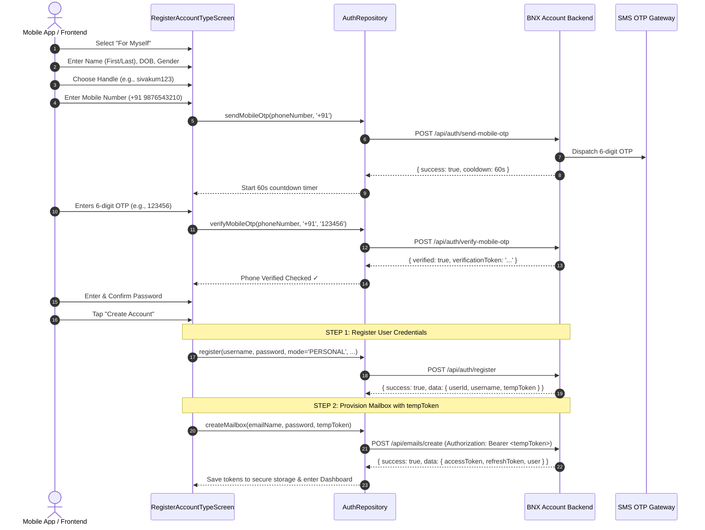
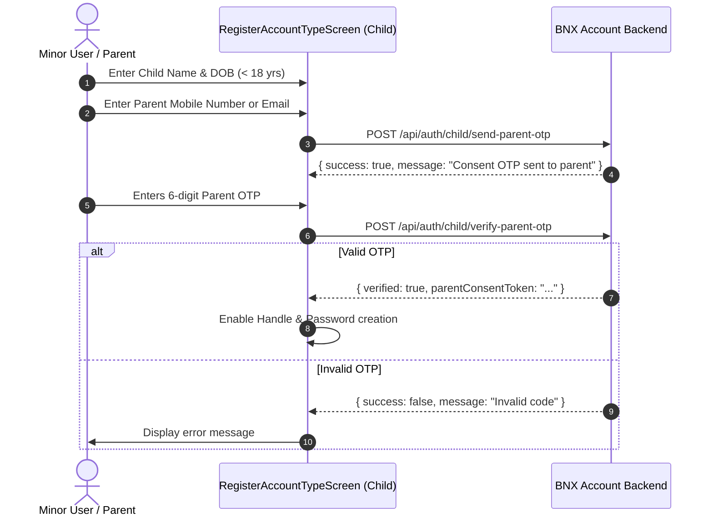
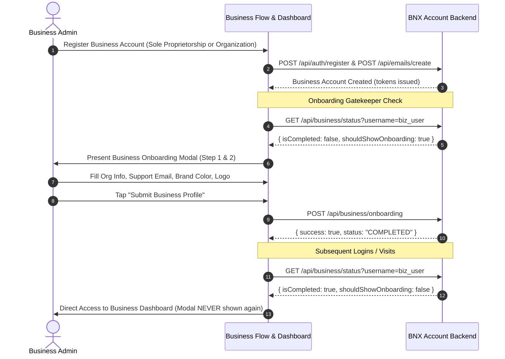
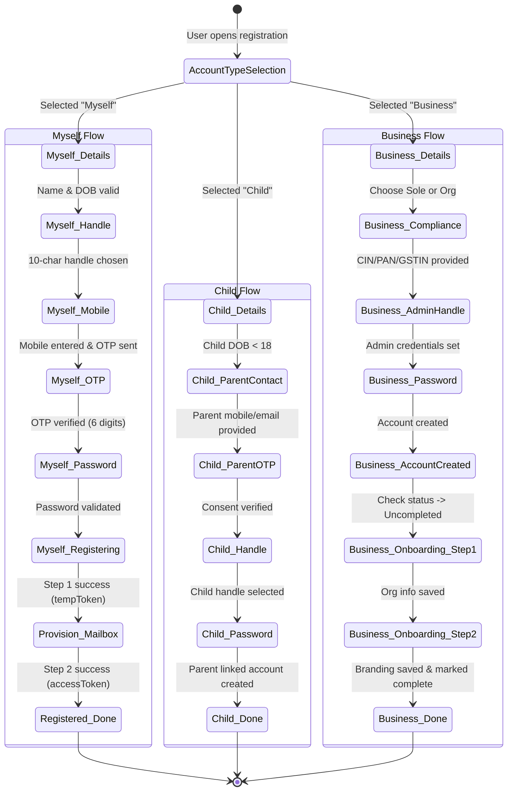

# BNX Account Flow & Architecture Specification

This document provides complete sequence diagrams, state machines, and lifecycle specifications for all Account operations in the BNX Mail ecosystem.

---

## 1. 2-Step Registration Architecture (Personal / Myself)

---

## 2. Child Account Parent Consent OTP Flow

---

## 3. Business Account & First-Time Onboarding Gatekeeper

---

## 4. Multi-Step Registration Wizard State Machine

